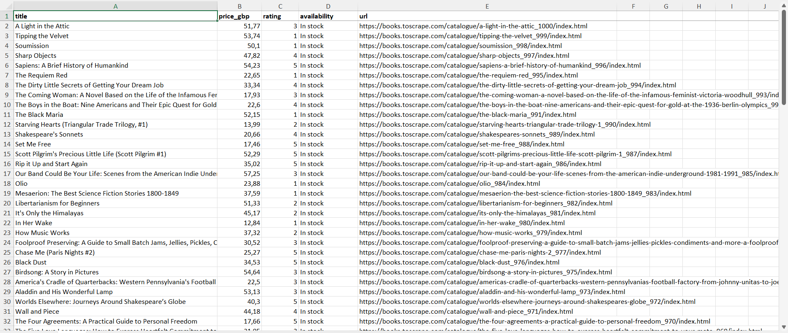

# Book Catalogue Scraper

A small Python tool that scrapes book data (title, price, rating, availability, URL) from [books.toscrape.com](https://books.toscrape.com), a sandbox site built for scraping practice, and exports it to **CSV** and **Excel**.

## Features
- Scrapes multiple pages automatically and stops when pages run out
- Retries on network errors and waits between requests (polite scraping)
- Clean output: numeric prices, numeric star ratings
- Excel export with bold header, sized columns and frozen first row
- Simple command-line options

## Installation
```bash
pip install -r requirements.txt
```

## Usage
```bash
# first 3 pages, CSV + Excel
python scraper.py

# 10 pages, Excel only, custom file name
python scraper.py --pages 10 --format xlsx --output my_books
```

| Option | Description | Default |
|---|---|---|
| `--pages` | Max number of pages to scrape | 3 |
| `--format` | `csv`, `xlsx` or `both` | both |
| `--output` | Output file name (no extension) | books |
| `--delay` | Seconds between requests | 0.5 |

## Output example
| title | price_gbp | rating | availability | url |
|---|---|---|---|---|
| A Light in the Attic | 51.77 | 3 | In stock | https://books.toscrape.com/... |

## Need something similar?
I build custom scrapers and automation scripts in Python. Find me on Fiverr: [My Fiverr Gig](https://www.fiverr.com/s/8xyxXbz)
